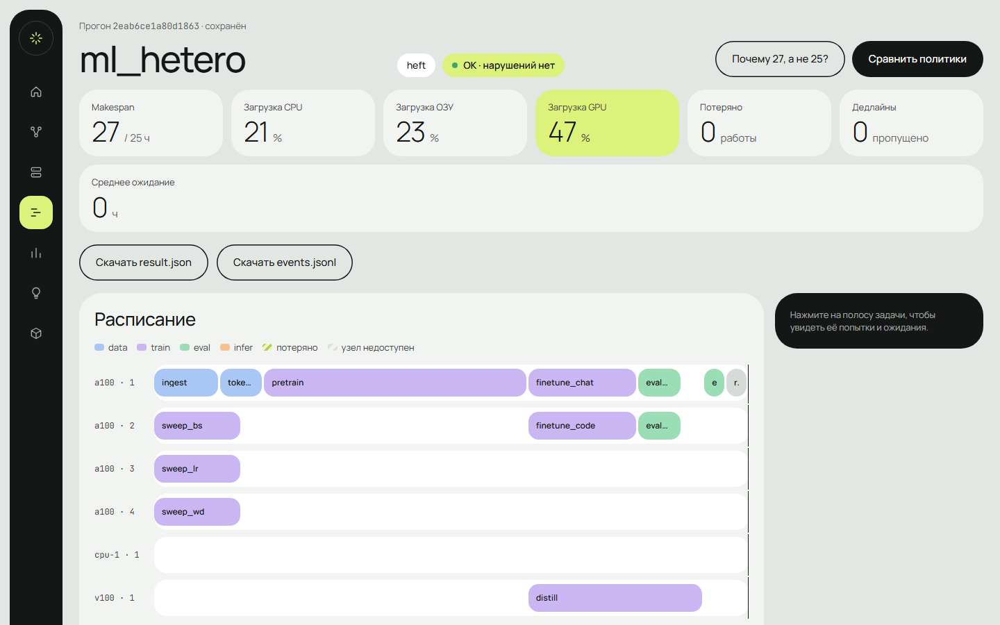
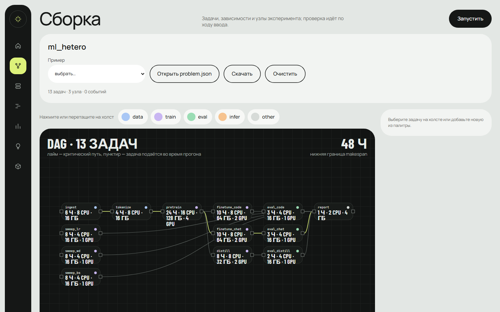
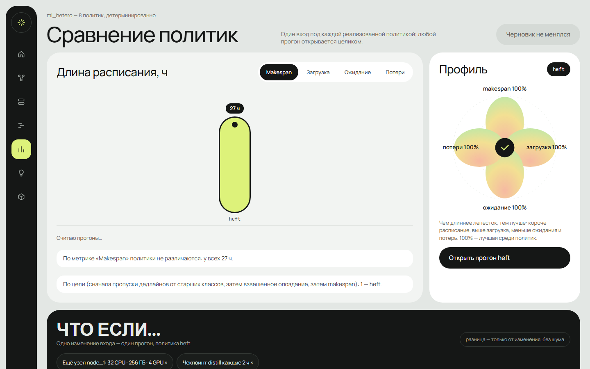
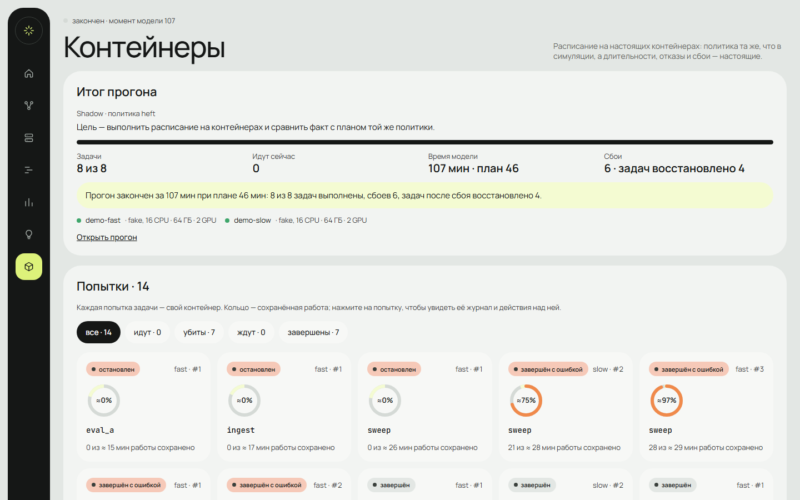
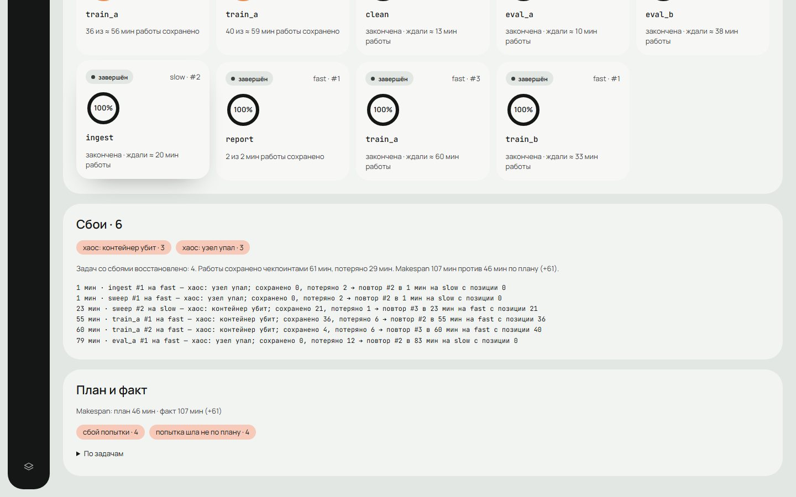

# expsched

Планировщик вычислительных экспериментов. На вход — DAG задач (подготовка данных, обучение, оценка,
инференс) с требованиями к ресурсам, приоритетами и дедлайнами и кластер узлов разной скорости; на выходе —
расписание, его независимая проверка, метрики и объяснение, почему каждая задача ждала. То же расписание можно
прогнать на настоящих контейнерах на агентах — с отказами, хаосом и восстановлением с чекпоинтов.



- **Политики:** `fifo`, `fifo_skip`, `priority`, `priority_backfill` (резервы, вытеснение по классу,
  старение), `heft` и `peft` (узлы разной скорости), `las` (Tiresias — без длительностей), `cpsat` (план
  решателем OR-Tools).
- **Модель длительности:** работа в единицах эталонного узла, скорость узлов, закон ускорения по числу
  CPU/GPU; длительность может быть неизвестна — тогда оценка (своя, по истории прогонов, по похожим задачам),
  которая уточняется по ходу из прогресса задачи. Подробно — [docs/model.md](docs/model.md).
- **Отказы:** прерванная задача продолжает с последнего чекпоинта на другом узле; поданные во время прогона
  задачи; вытеснение ради дедлайна или по приоритету; перепланирование с видимыми сдвигами.
- **Проверка и объяснения:** коды ошибок входа с подсказками, побайтово одинаковый журнал на одном входе,
  критическая цепочка, причины ожидания, простой узлов, сравнение политик и what-if.
- **Агенты:** Docker, Podman, gravesentinel (снимки CRIU) или fake без контейнеров; режимы emulate, shadow
  (план рядом с фактом) и replay; «Убить контейнер», хаос и демо одной кнопкой.

|  |  |
|---|---|
|  |  |

## Быстрый старт

Нужны Python 3.12, [uv](https://docs.astral.sh/uv/) и Node.js 20.

```bash
uv sync --all-extras
make web-install   # зависимости JS-клиента
make run           # интерфейс и REST API на http://127.0.0.1:8000
```

Дальше — [руководство](docs/guide.md): от примера в «Сборке» до прогона на контейнерах. Самый короткий путь
к прогону на агентах — «Контейнеры» → «Запустить демо»: сервер сам поднимет двух агентов без контейнеров и
прогонит пример со сбоями. Показ на 10 минут — [docs/demo.md](docs/demo.md).

Сервис рассчитан на запуск на своей машине: авторизации нет, сервер слушает только 127.0.0.1, а размер
входа, очередь прогонов, их время, память рабочих процессов и место под прогоны ограничены (см.
[REST API](docs/api.md)). Что есть в интерфейсе — [ui/README.md](ui/README.md).

Или в Docker, без Python и Node на машине:

```bash
docker compose up --build   # http://127.0.0.1:8000, прогоны — в томе expsched-runs
```

Образ ([`Dockerfile`](Dockerfile)) собирает клиент на Node и окружение через uv, а работает на `python:3.12-slim`
от непривилегированного пользователя. [`compose.yaml`](compose.yaml) открывает порт только на 127.0.0.1
(авторизации в сервисе нет), монтирует корень только для чтения, сбрасывает capabilities и ограничивает память.
Состояние — `docker compose ps` (HEALTHCHECK опрашивает `/v1/policies`).

Из Python:

```python
from pathlib import Path

from expsched.contract.io_models import PolicyIn, load
from expsched.pipeline import run

problem = load(Path("scenarios/failure.json").read_bytes())
out = run(problem, PolicyIn(name="priority"))

assert out.result["status"] == "OK"
assert out.result["metrics"]["makespan"] == 22
assert out.result["metrics"]["lost_work"]["gpu"] == 4  # час работы на 4 GPU после последнего чекпоинта
assert out.result["violations"] == []
```

Через API (ответ — `run_id` и результат; по `run_id` читаются журнал, объяснения и варианты what-if, см.
[REST API](docs/api.md)):

```bash
curl -s localhost:8000/v1/runs -H 'content-type: application/json' \
  -d "{\"problem\": $(cat scenarios/demo.json)}"
```

## Примеры входа

| Файл | Что показывает |
|---|---|
| `scenarios/demo.json` | 10 задач на 3 узлах и срочная задача, поданная в t = 9 |
| `scenarios/failure.json` | тот же DAG, node-A недоступен с 5 до 15 |
| `scenarios/urgent_failure.json` | отказ и срочная задача вместе |
| `scenarios/backfill.json` | `priority_backfill`: крупная задача получает резерв, мелкая заполняет дыру |
| `scenarios/preemption.json` | срочная задача вытесняет фоновую, чтобы успеть к дедлайну |
| `scenarios/cycle.json` | ошибки входа: цикл, неизвестная зависимость, повтор ребра |
| `scenarios/hetero_gpus.json` | метки и ресурсы помимо GPU: данные — на CPU-узел, большая модель — на A100 |
| `scenarios/fragmentation.json` | у каждой политики свой простой: FIFO за широкой задачей, жадные дробят место |
| `scenarios/sweep.json` | перебор гиперпараметров: сборка результатов ждёт самый медленный запуск |
| `scenarios/deadline_crunch.json` | демо успевает только ценой вытеснения ночной задачи; FIFO опаздывает |
| `scenarios/cascade.json` | отказы подряд: хрупкая задача без ретраев падает, узел не возвращается |
| `scenarios/rush_hour.json` | поток срочных задач вытесняет фоновую ровно один раз |
| `scenarios/staggered.json` | данные приходят позже: ожидание видно в объяснениях |
| `scenarios/invalid_mix.json` | lenient: ошибочные части пропущены, остальное планируется |
| `scenarios/priority_preemption.json` | срочные задачи без дедлайна вытесняют фоновую, у которой меньше теряется |
| `scenarios/laptop.json` | один ноутбук без GPU (8 ядер, 16 ГБ): задача ждёт памяти, хотя ядра свободны |
| `scenarios/ml_platform.json` | 39 задач на 5 узлах: отказ a100-2 стоит демо руководству 6 ч опоздания |
| `scenarios/ml_hetero.json` | узлы разной скорости и законы ускорения: heft и cpsat вдвое быстрее backfill |
| `scenarios/two_machines.json` | две машины — два агента: у каждого узла свой |
| `scenarios/criu_pairs.json` | gravesentinel: задачи на парах CPU с чекпоинтами CRIU |
| `scenarios/chaos_demo.json` | демо сбоев: две машины разной скорости, неизвестные длительности, хаос |

## Документация

- [Руководство](docs/guide.md) — сценарии работы, в том числе как запускать прогоны на агентах.
- [Демо на 10 минут](docs/demo.md)
- [Формат входа](docs/input.md) — `problem.json`, поля и значения по умолчанию.
- [Как строится расписание](docs/scheduling.md) — симуляция, политики, отказы, причины ожидания, проверка
  и метрики.
- [REST API](docs/api.md)
- [Протокол агента](docs/agent.md) — как агент запускает задачи в контейнерах и сообщает о них.
- [Модель длительности](docs/model.md) — работа, скорость узлов, закон ускорения и оценки задач без длительности.
- [Контейнеры](containers/README.md) — образ нагрузки и гипервизор чекпоинтов gravesentinel (C++/Bazel, Podman + CRIU).
- [Архитектура](docs/architecture.md) — пакеты, слои и правила зависимостей.
- [Интерфейс](ui/README.md) и [JS-клиент](ui/web/README.md) — экраны, разработка, сквозные проверки.
- [Разработка](CONTRIBUTING.md), [изменения](CHANGELOG.md)

## Ограничения

- `cpsat` планирует только по известному сейчас и без вытеснений; больше 150 незавершённых задач — решения
  принимает `priority_backfill`.
- Режимы — `simulate`, `emulate` (прогон на [агентах](docs/agent.md)), `shadow` (то же с планом рядом) и
  проигрывание сохранённого прогона (`POST /v1/runs/{id}/replay`).
- Прогон на агентах проверен нагрузкой до 20 агентов и 500 задач (`scripts/load_agents.py`): тик драйвера —
  в среднем 5–30 мс, не дольше 0,2 с; подготовка и итог прогона (до 3 с) идут вне цикла событий.
- На широких DAG (10⁴ задач, тысячи готовых одновременно) прогон занимает до 20 с: очередь политики
  пересчитывается каждую эпоху.
