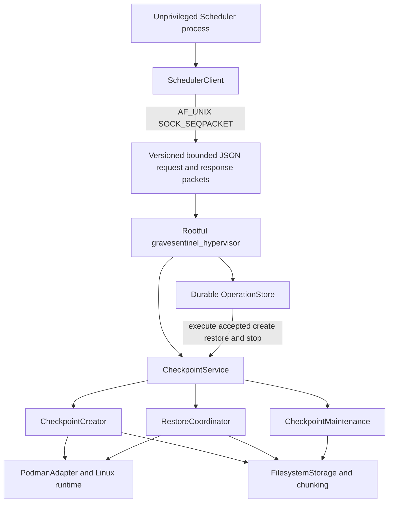
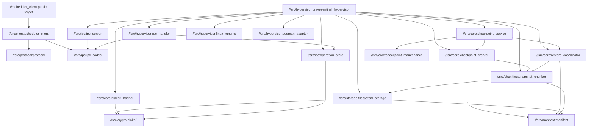
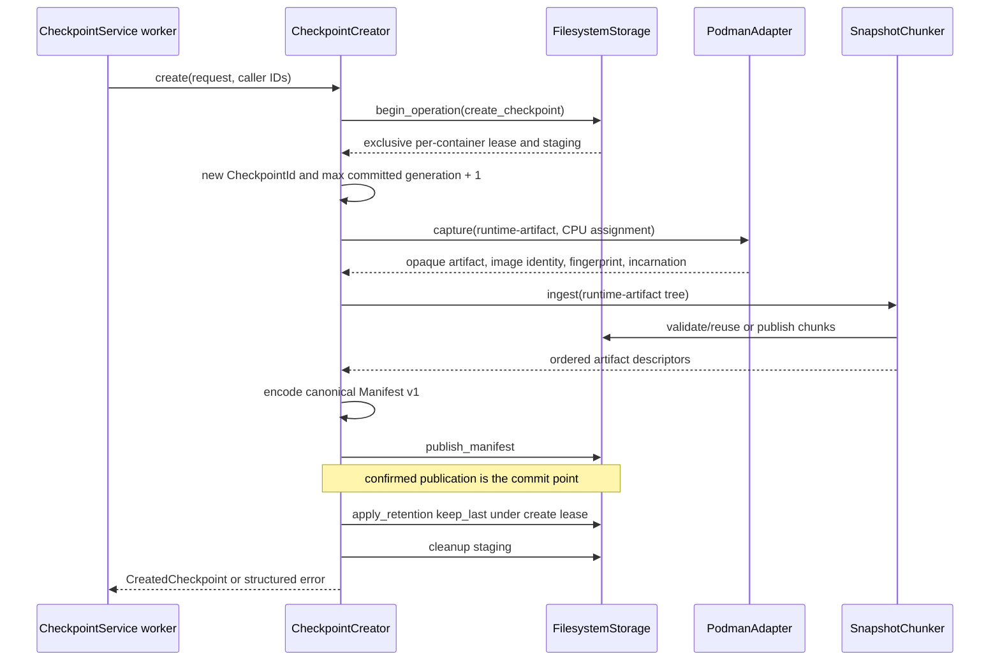
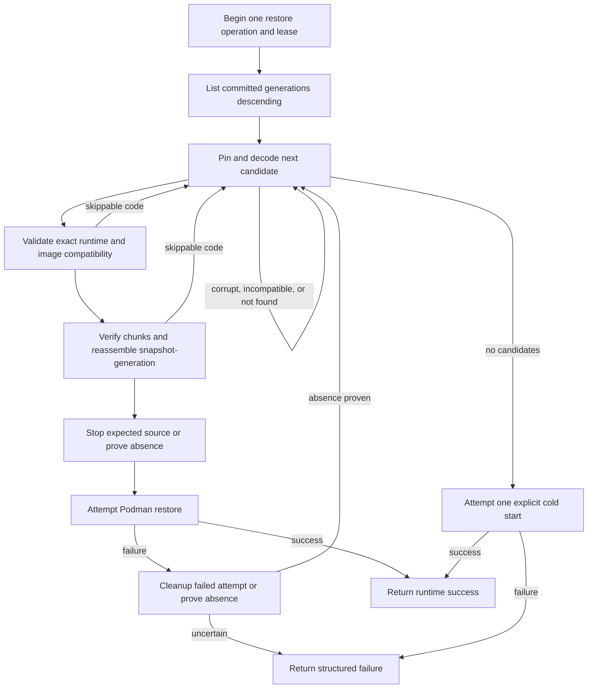

# Checkpoint Cache Manager: MVP Architecture

## Purpose and Current Status

This document describes the CCM components **actually present in the repository**,
their process, persistence, and privilege boundaries, and the lifecycle work that is
still absent. Normative details of formats and algorithms are provided in the related
documents listed in the [documentation index](README.md).

The current code includes:

| Area | Implementation | Status |
| --- | --- | --- |
| Common types and validation | `//src/protocol:protocol` | implemented, unit-tested |
| Manifest v1 and BLAKE3 | `//src/manifest:manifest`, `//src/crypto:blake3` | implemented, unit-tested |
| Crash-safe storage | `//src/storage:filesystem_storage` | implemented, unit-tested |
| Chunking/reassembly | `//src/chunking:snapshot_chunker` | implemented, unit-tested |
| Linux process/affinity boundary | `//src/hypervisor:linux_runtime` | implemented, unit-tested |
| Podman/CRIU adapter | `//src/hypervisor:podman_adapter` | implemented, unit-tested, includes an opt-in adapter smoke test |
| Create orchestration | `//src/core:checkpoint_creator` | implemented, unit-tested |
| Restore/fallback/cold start | `//src/core:restore_coordinator` | implemented, unit-tested |
| Registration/scheduling service core | `//src/core:checkpoint_service` | implemented, unit-tested |
| IPC codec and server | `//src/ipc:ipc_codec`, `//src/ipc:ipc_server` | implemented, unit-tested |
| Durable async operation store | `//src/ipc:operation_store` | implemented, unit-tested |
| Scheduler client | `//src/client:scheduler_client` | implemented, unit-tested |
| Retention, chunk GC, and startup recovery | `//src/core:checkpoint_maintenance`, `//src/storage:filesystem_storage` | implemented, unit-tested |
| Production composition | `//src/hypervisor:gravesentinel_hypervisor` | implemented and buildable |

`gravesentinel_hypervisor` constructs filesystem storage, hashing, chunking, the
Podman adapter, create/restore coordinators, `CheckpointMaintenance`,
`CheckpointService`, the durable operation store, RPC handler, and Unix socket server.
After acquiring the process lock and opening storage, it completes bounded startup
recovery before constructing the service or journal and before readiness. Storage
runtime-artifact paths and the
Podman adapter share `checkpoint-data` as their trusted staging boundary; the adapter
unit test obtains its capture directory from a real `FilesystemStorage` operation.
This is a real production composition, not a stub. Unit tests cover its components and
IPC behavior. The complete production binary-to-Podman/CRIU stage-12 path and both
stage-13 suites qualified rootfully on 2026-10-25 for the then-current protocol-v2
code. Protocol v3 added runtime status/adoption and durable stop/remove, so those
markers are historical and affected rootful suites must be rerun before release. The
runtime remains intentionally restricted to the separately qualified destructive
rootful profile.

## Process Boundary and Privilege Separation

The Scheduler and CCM do not share an address space. The Scheduler owns the desired
set of registrations and uses the concrete `SchedulerClient` through
`IHypervisorClient` from the public `//:scheduler_client` target and
`<gravesentinel/scheduler_client.hxx>`. The client is privilege-free and depends only
on protocol types plus its private IPC
codec implementation.

The implemented process boundary is:



Both ends authenticate their peer with `SO_PEERCRED`. `SchedulerClient` expects the
server UID to be 0 unless an explicit alternative is supplied. The server accepts
only `--scheduler-uid` when configured; when it is omitted, the accepted peer UID is
the server effective UID. The socket has configurable `--socket-gid` and
`--socket-mode` (default `0660`) for filesystem access control, but group membership
does not replace the server's exact UID check. A normal privilege-separated
deployment therefore runs the hypervisor in the qualified rootful context, grants a
specific scheduler UID access to the socket, and configures that same UID as the
server's allowed peer.

Only the hypervisor process invokes rootful Podman/CRIU. `IProcessRunner` accepts an
executable and a separate `argv`; the production `PosixProcessRunner` uses `execve`
rather than shell concatenation. The only accepted runtime profile is
`podman-criu-rootful-v1`; the composition defaults to `/usr/bin/podman` and
`/usr/sbin/criu`. Scheduler-facing code does not depend on storage, Podman, CRIU, or
Linux APIs.

## Actual Bazel Target Graph

The condensed production dependency graph is:



The executable's application library has direct edges to the service, orchestration,
runtime, IPC, and storage targets; `main.cxx` is only the entry point. `ccm_core` still
contains contracts and structured errors rather than workflow implementations. The
root `//:scheduler_client` library wraps the concrete client and public include path;
its JSON codec is an implementation dependency rather than part of the public API. BLAKE3 `1.8.2.bcr.1`, nlohmann JSON `3.12.0.bcr.2`, and
GoogleTest `1.18.0.bcr.1` are pinned in `MODULE.bazel`.
`//tests/unit:unit_tests` is an aggregating test suite, not a library node in this
dependency graph.

## Identities and Configuration

`ContainerId`, `CheckpointId`, `RequestId`, `OperationId`, and
`RuntimeContainerRef` are distinct strong types. Their underlying factory rejects only
an empty value and an embedded NUL. Stricter constraints are imposed at other layers:

- Manifest v1 and `FilesystemStorage` limit container/checkpoint/storage IDs to 256
  bytes;
- manifest metadata must be valid UTF-8 without control characters;
- the runtime adapter applies its own constraints to Podman names, image references,
  argv, and the environment.

A direct in-process caller can still construct a strong identifier that a later layer
rejects. The wire boundary is stricter: every identifier is 1–128 bytes and contains
only ASCII letters, digits, `_`, `-`, `.`, or `:`. Storage and runtime checks are
repeated after decoding rather than relying on transport validation alone.

`CheckpointConfig` has defaults of `interval = 60s` and `keep_last = 3`. The
`Register` request uses this exact `ContainerRegistration` parameter shape; every
listed key is required, unknown keys are rejected, and the two optional values are
represented explicitly as either `null` or the complete object:

```text
{
  "container_id": string,
  "runtime_container": string,
  "checkpoint": {
    "interval_seconds": integer,
    "keep_last": integer,
    "container_cpu": integer,
    "checkpoint_cpu": integer
  },
  "cold_start": null | {
    "image_reference": string,
    "argv": [string, ...],
    "environment": [{"name": string, "value": string}, ...],
    "mounts": [{"source": string, "target": string, "read_only": boolean}, ...],
    "runtime_options": [string, ...]
  },
  "runtime_fingerprint": null | {
    "runtime_name": string,
    "runtime_version": string,
    "runtime_build_origin": string,
    "architecture": string,
    "kernel_release": string,
    "criu_version": string,
    "oci_runtime_name": string,
    "oci_runtime_version": string,
    "oci_runtime_commit": string,
    "oci_runtime_features": string,
    "cgroup_version": string,
    "cgroup_manager": string,
    "cgroup_controllers": string,
    "privilege_mode": string,
    "user_namespace_mode": string,
    "capability_profile": string,
    "selinux_mode": string,
    "apparmor_profile": string,
    "seccomp_profile": string,
    "command_profile": string
  }
}
```

Registration validation requires:

- `interval_seconds` in `1..31536000` and `keep_last` in `1..3`;
- one of the CPU pairs `(0,1)`, `(2,3)`, `(4,5)`, `(6,7)`;
- no more than four registrations, with no duplicate CPU assignments;
- a bounded and syntactically valid `ColdStartSpec`, including unique environment
  names and the complete arrays shown above;
- non-empty fields in the registration-level `RuntimeFingerprint`, if specified.

One field currently does not affect the workflow after validation:

- `ContainerRegistration::runtime_fingerprint`, because create stores the fingerprint
  measured by the adapter, while restore uses the fingerprint from the manifest.

`ColdStartSpec` is separate from the mutable runtime ID. Command profile v1 prohibits
mounts and arbitrary runtime options. The production adapter passes the environment
through a transient mode-`0600` env-file rather than through Podman argv or the process
environment. Names and values are validated further; NUL, CR, and LF are prohibited.

## Internal Interfaces and Concrete Guarantees

`//src/core:ccm_core` declares:

- `ICheckpointService` — synchronous register/unregister/create/restore/status/stop/shutdown;
- `IStorage`, `IStorageOperation`, and `IStorageMaintenanceOperation` — namespace
  reads, create/restore leases and staging, lease-only retention/GC, publication,
  pinning, and cleanup; concrete `FilesystemStorage` additionally exposes startup
  recovery;
- `IPodmanAdapter` — compatibility, capture, runtime inspection, absence, restore,
  cold start, and ownership-fenced stop/remove;
- `IClock`, `ITimer`, `IHasher`, `IIdGenerator` — injectable dependencies;
- `ILogger` — structured diagnostic sink;
- `IAffinityController` and `IThreadAffinityBinding` — CPU validation/binding;
- `IProcessRunner` — exact argv/environment, bounded output, and typed termination;
- `CheckpointResult<T>` — `std::expected<T, CheckpointErrorDetail>`.

The shape of an interface does not prove all operational properties. For example, an
arbitrary `IStorage` implementation is not necessarily crash-safe or cross-process,
and an arbitrary collaborator may return diagnostics containing sensitive data. The
following properties apply to the production classes:

| Property | Implementing boundary |
| --- | --- |
| Cross-process per-container `flock` | `FilesystemStorage` |
| Temp + file `fsync` + no-replace publish + directory `fsync` | `FilesystemStorage` |
| Descriptor-relative no-follow reads | `FilesystemStorage`, chunker/reassembler |
| Mount-ID containment for the snapshot tree | `SnapshotChunker`/`SnapshotReassembler`, not storage as a whole |
| BLAKE3 verification of chunk contents | chunker/reassembler, not the raw storage API |
| Exact Podman/CRIU profile and ownership checks | `PodmanAdapter` |
| Shell-free child execution and process-group timeout | `PosixProcessRunner` |
| Same-container serialization within one service | `CheckpointService` |
| Bounded strict JSON request/response packets | IPC codec and `SOCK_SEQPACKET` server/client |
| Server and client peer-UID checks | IPC server and `SchedulerClient` via `SO_PEERCRED` |
| Strict oldest-first retention, candidate-based chunk GC, and startup recovery | `FilesystemStorage` through `CheckpointMaintenance` |
| Durable operation acceptance, deduplication, and crash classification | `OperationStore` |

All injected implementations must follow the calling layer's thread-safety and
sanitization rules. Core passes collaborator diagnostics to the logger without
universal secret redaction.

## Create Data Flow

A direct `CheckpointCreator::create` call returns a rich `CreatedCheckpoint`; the
service wraps it in `CheckpointResult<void>` and stores only the runtime incarnation
for the next restore.



The manifest is published last. Before that, published chunks are orphan candidates
and do not constitute a committed checkpoint. A directory-`fsync` failure after the
manifest rename produces `publication_may_be_visible`: the operation returns failure,
but the manifest may already appear in the next listing and occupy the generation.
After confirmed commit, retention strictly validates all roots and removes excess
manifests oldest-first for `keep_last` `1..3`. Retention failure or exception leaves the
create successful with `retention_complete = false`; the service schedules a separate
lease-only retry.

The direct core remains synchronous and does not maintain an idempotency table. In
the production RPC path, however, `SubmitCreateCheckpoint` is first durably recorded
by `OperationStore`; its deterministic `OperationId` is then passed into the service
and storage transaction. Repeating the same `RequestId` with the same canonical
method/container payload returns that operation instead of capturing again, including
after restart. A direct in-process retry or a submission with a new request ID is a
new capture attempt.

Full details: [checkpoint-create.md](checkpoint-create.md).

## Restore Data Flow

A direct `RestoreCoordinator` call returns a `RestoredContainer` with an outcome,
incarnation, checkpoint metadata, and cleanup flags. `ICheckpointService` returns only
success/error and uses the incarnation as an internal fence. Across IPC,
`SubmitRestoreOrRestart` is durable and asynchronous; clients poll `GetOperation` for
a terminal state.



The fallback decision currently depends on the stable error code: `not_found`,
`corrupted_snapshot`, and `incompatible_runtime` are skippable regardless of which
collaborator produced them. Collaborators must therefore not mask a control-plane
failure with one of these codes.

The first suitable candidate is fully reassembled before the known source incarnation
is stopped. After a failed restore and confirmed cleanup, older candidates are checked
during downtime. This is important when estimating worst-case recovery latency.

Full details: [checkpoint-restore.md](checkpoint-restore.md).

## Service Core: Concurrency and Scheduling

`CheckpointService` supports at most four registration slots. Each slot has one
persistent worker pinned to `checkpoint_cpu`; create, restore, retention, and GC all
reuse it. There is no fifth CPU-heavy worker. The control caller thread is not rebound.
Linux CPU availability checks use the process leader's allowed mask rather than the
already narrowed worker mask, so adapter validation of `container_cpu` remains valid
while the caller is pinned to `checkpoint_cpu`.

Within a slot, work selection priority is manual foreground, periodic create, retention,
then GC. Periodic creates skip busy ticks without catch-up. Maintenance uses coalesced
flags; GC is due every five minutes, and a successful create also requests GC.
Incomplete immediate retention coalesces a separate retention pass immediately.
If that pass reports incomplete, or a maintenance pass fails retryably or throws, the
next retry is delayed by 30 seconds. Non-retryable failures wait for a new create or
periodic trigger. A GC report with `more_work` coalesces another bounded pass. Continuous
foreground backlog can delay maintenance until quiescence.

The same storage `flock` serializes all four operation kinds across threads and
processes. A restore pin may outlive its operation owner and retains that lease, thereby
deferring maintenance. Active maintenance makes unregister return a retryable conflict;
a successful unregister and shutdown drop queued maintenance. Shutdown lets an already
active bounded pass finish before joining the worker. Background maintenance is logged
but never entered in the public `OperationStore` journal.

Limitations remain: FIFO/fairness among foreground callers is not guaranteed; operation
cancellation and service-level deadlines are absent; a hung collaborator may delay its
caller and shutdown; periodic/background results are available only through `ILogger`;
the periodic request ID may repeat after unregister/re-register; scheduler-loop failure
is not exposed by general health; and affinity restoration errors cannot be reported by
the destructor.

Details: [service-core.md](service-core.md) and [maintenance.md](maintenance.md).

## Persistence Boundary

A committed checkpoint is defined by the presence of a canonical manifest, not staging
or a chunk. With the production defaults, the daemon-owned persistence layout is:

```text
/var/lib/gravesentinel/
  operations.jsonl
  hypervisor.lock
  checkpoint-data/                 # storage root and Podman trusted staging root
    containers/<container-key>/
      identity
      manifests/<20-digit-generation>.json
      gc-candidates/<64-hex-blake3>
      chunks/<two-hex-prefix>/<64-hex-blake3>
      staging/<operation-key>/...
    locks/<container-key>.lock
    tmp/
```

Raw checkpoint IDs do not become storage path components: storage uses
domain-separated BLAKE3 keys and checks the immutable `identity`. The storage operation
lease is held until the operation state is destroyed; a
longer-lived pin extends the lease. Manifest/chunk publication and GC candidate
publication are immutable and no-replace; retention and sweep unlink durably with a
parent-directory `fsync`.

`hypervisor.lock` is opened without following symlinks, validated as a single-link
regular file owned by the daemon, forced to mode `0600`, and exclusively locked before
checkpoint storage or `operations.jsonl` is opened. The lock remains held through
service shutdown, so a losing second process cannot recover or compact the live journal.

Before `operations.jsonl` or the service is created, startup recovery takes each
available container lease, immediately removes exact canonical publication temporaries,
removes stale canonical staging after the configured grace, and runs GC with at most
128 chunk deletions per container per pass.
It repeats while `more_work` within a bounded 1024-pass startup loop. There is no
startup retention because registrations and their `keep_last` values are not available.
Partial namespaces without `identity` and noncanonical recovery names are left
untouched; an unknown entry in the manifest root of a complete namespace instead fails
the strict GC scan.

`operations.jsonl` is a separate mode-`0600`, daemon-owned durable journal. Acceptance,
the transition to `running`, and terminal state changes are appended and `fsync`ed.
Compaction writes one current record per operation to a fresh mode-`0600` file,
`fsync`s it, renames it over the journal, and `fsync`s the parent directory. Startup
also compacts after recovery. The journal and registry have configured entry, byte,
in-flight, identifier, request, and result bounds.

Pre-release journals written by the earlier prototype with PID-suffixed operation IDs
are intentionally not migrated: strict recovery requires the deterministic
`op-<BLAKE3(request_id)>` identity and fails closed on those records. Such a prototype
journal must be archived or removed before starting this version.

`FilesystemStorage` trusts a pre-created absolute root and an administrator who does
not change the namespace under the running process. It applies descriptor-relative
and no-follow checks, but mount-ID containment for snapshot trees is provided only by
chunking/reassembly. NFS/FUSE/overlay and filesystems without reliable directory
`fsync` have not been qualified.

Details: [filesystem-storage.md](filesystem-storage.md),
[chunking.md](chunking.md), [manifest-v1.md](manifest-v1.md).

## Runtime Boundary

`PodmanAdapter` implements only `podman-criu-rootful-v1`. It checks the exact
fingerprint, immutable image ID, ownership labels, cpuset, and immutable 64-hex runtime
ID. `ContainerId`, stable `RuntimeContainerRef`, and single-lifetime
`RuntimeIncarnation` are not interchangeable.

The main safety rules are:

- capture uses an opaque `checkpoint.tar` and `--leave-running`;
- the source image must remain available in the local Podman image store for restore;
- runtime status validates ownership labels, cpuset, and immutable runtime ID before
  reporting `running`/`exited`; a successful service-level inspection adopts that
  incarnation, while `absent` clears the cached fence;
- stop/remove is permitted only for the expected incarnation; after daemon restart it
  first inspects/adopts when no incarnation is cached, and an already absent runtime is
  a successful desired state;
- `confirm_absence` performs both regular and external read-only existence probes;
- destructive failed-restore cleanup is permitted only after its own attempt, which
  began when absence had been proven under a continuous per-container lease;
- an unknown fingerprint or image mismatch fails closed;
- runtime stderr is not included in production adapter diagnostics;
- the daemon passes only `PATH`, `HOME`, `XDG_RUNTIME_DIR`, and
  `DBUS_SESSION_BUS_ADDRESS` from its own environment to Podman/CRIU. Workload
  environment remains separate and uses the transient mode-`0600` env-file contract.

Qualification is tied to a specific rootful host profile and makes no general claims
about other kernels, versions, architectures, or security policies. The destructive
Podman/CRIU flow must be run only in such a qualified environment. The existence of
the production composition and its unit tests is not evidence that the complete
production daemon flow has been run there. See [testbed.md](testbed.md) and
[ADR 0001](adr/0001-podman-criu-runtime-profile.md).

## Errors and Indeterminate Side Effects

`CheckpointErrorDetail` contains:

- a stable `StableErrorCode`;
- an internal diagnostic;
- `retryable`;
- an optional correlation `RequestId`;
- `StorageSideEffect`;
- `RuntimeSideEffect`.

The two side-effect flags cannot be inferred from the error code alone:

- `publication_may_be_visible` means that an immutable publication may have become
  visible even though durability was not confirmed;
- `incarnation_may_exist` means that a runtime incarnation may have been created,
  stopped, removed, or its final absence was not proven.

After such a result, a destructive action must not be retried automatically without
reconciliation/absence proof. The service conservatively adds these flags to
exceptions because the exception may have occurred after an opaque side effect.

Arbitrary internal diagnostics do not cross the wire. `GetOperation` exposes only the
operation ID, state, and a stable error code for `failed` or `indeterminate` terminal
states.

A journal-level `indeterminate` state is deliberately conservative. It can result
from recovery of a `running` record, an exception after an opaque executor side
effect, a core side-effect flag, or failure to persist a terminal result. The scheduler
or an operator must reconcile checkpoint publication and runtime presence before a
new destructive attempt.

## Implemented IPC and Async Operation Contract

IPC is local `AF_UNIX/SOCK_SEQPACKET` request/response transport. Each JSON request and
response occupies one packet and is limited to 256 KiB. The protocol-v3 envelopes are:

```text
request  = {"version": 3, "method": string, "request_id": string,
            "params": object}
success  = {"version": 3, "request_id": string, "ok": true,
            "result": object, "close_connection": bool}
failure  = {"version": 3, "request_id": string, "ok": false,
            "error_code": string, "close_connection": bool}
```

The codec rejects unknown envelope fields, methods, protocol versions, malformed or
oversized packets, invalid identifier syntax, and method parameters outside their
exact schema. `SchedulerClient` starts each connection with `Handshake`;
`GetHealth`, `Register`, `Unregister`, `GetRuntimeStatus`,
`SubmitCreateCheckpoint`, `SubmitRestoreOrRestart`, `SubmitStopContainer`, and
`GetOperation` are implemented. Individual packet
reads/writes have deadlines, the server has a bounded accepted-peer queue, and each
connection serves a bounded number of requests. The final allowed response sets
`close_connection=true`; the client closes that descriptor before issuing another
request, avoiding a race where a mutating packet could be accepted by the kernel after
the server had stopped reading that connection.

Create, restore, and stop/remove use durable asynchronous submission:

1. submission with a caller `RequestId` persists `queued` before success is returned;
2. the operation ID is deterministically `op-` plus the BLAKE3 digest of the request
   ID, so the same journaled request has the same ID after restart;
3. the worker durably records `running` before calling the synchronous service;
4. `GetOperation` reports `queued`, `running`, `succeeded`, `failed`, or
   `indeterminate`;
5. the high-level synchronous `bool` client methods submit and poll until the
   configured operation timeout, returning `true` only for `succeeded`.

An identical request ID plus canonical method/container payload is deduplicated and
returns the existing operation. Reusing a request ID with a different method,
container, or payload is a conflict. Async submission transport retries reuse the same
request ID, so an ambiguous response does not create a second operation. A disconnect
does not cancel accepted work.

`Register` and `Unregister` are synchronous and are not journaled. The client may retry
connection establishment before an exchange, but once a request/response exchange
fails ambiguously it does not transport-retry that mutation. It returns failure and
the scheduler must reconcile registration state rather than assume the request did or
did not execute. At the in-process core boundary, `Unregister` returns
`StableErrorCode::conflict` with `retryable=true` without changing a registration that
has active work. Protocol v3 intentionally collapses synchronous Register/Unregister
service failures to `request_failed`, and the boolean client returns `false`; the
scheduler must reconcile state and decide whether to retry.

On journal recovery, a `queued` record is durably changed to `failed` with the
`interrupted`/failed-before-execution classification; it is never executed after
restart. A `running` record is durably changed to `indeterminate` and requires
reconciliation. Terminal operations are not rerun.

The registry is intentionally bounded. Background retention, GC, and startup recovery
are not public operations and create no records in this journal. With
`eviction_batch` set (the hypervisor uses 512 of `max_records` 4096), a submission
that finds the registry full first forgets up to that many of the oldest `succeeded`
or `failed` operations and compacts the journal once, so recovery cannot revive them.
`GetOperation` for an evicted operation returns `not_found`, and resubmitting its
`request_id` creates a new operation: deduplication covers the retained window only.
`queued`, `running`, and `indeterminate` records are never evicted; when nothing is
evictable, or with `eviction_batch` 0, new unique operations are rejected while known
duplicates and `GetOperation` remain available. Eviction order follows completion
within one daemon run; after a restart, recovered terminal records are evicted in
compacted-journal order (by operation ID), not by age. Local IPC is therefore authenticated and validated,
not implicitly trusted.

## Remaining Lifecycle Limitations

Retention, conservative chunk GC, immediate canonical publication-temporary cleanup,
stale staging cleanup, and startup pass repetition are implemented. The remaining lifecycle limitations are:

1. automatic reconciliation of indeterminate checkpoint publications or runtime
   incarnations (runtime status/adoption supplies the primitive, but policy remains a
   scheduler responsibility);
2. operation-history retention/administrative pruning to free bounded registry slots;
3. cancellation and service-level deadlines for already accepted operations.

The implemented `//tests/integration:hypervisor_scheduler_e2e` process-boundary
target completed successfully in the qualified rootful Podman/CRIU environment before
the protocol-v3 status/stop extension. That result is historical; affected rootful
suites must be rerun before releasing the current runtime lifecycle code.

Consequently, `keep_last` does limit committed manifests when immediate retention or a
retry completes, but registry saturation still rejects new unique public operations and
an indeterminate operation remains an explicit scheduler/operator responsibility. The
registration-level runtime fingerprint also remains validated but unused by create and
restore decisions.

## Build and Checks

The project uses Bazel `8.8.2`, Bzlmod, and C++23. Project-local Starlark macros enable
strict warnings and `-Werror` without imposing them on external repositories.

The primary check is:

```text
bazel test //:checks
```

It includes the clang-format test and `//tests/unit:unit_tests`. Focused stage 11
targets include `//tests/unit:checkpoint_maintenance_test`,
`//tests/unit:filesystem_storage_test`, `//tests/unit:checkpoint_service_test`, and
`//tests/unit:checkpoint_creator_test`. Broader commands are:

```text
bazel build //...
bazel test //...
bazel test //scripts:clang_format_test
```

Unlike `//:checks`, the wildcard test also finds non-manual tests outside the unit
suite, such as the integration fixture's unit test.

Manual integration targets are excluded from `bazel test //...`. They should be run
only in a qualified rootful environment according to the instructions in
[testbed.md](testbed.md). The complete process/IPC target is
`//tests/integration:hypervisor_scheduler_e2e`; it carries `manual`,
`requires-podman`, `exclusive`, and `local`. `bazel build //:hypervisor` builds the
composed daemon, but a successful build or unit-test run does not imply that the
destructive production end-to-end flow was executed.

Independent profiles `--config=debug`, `--config=release`, `--config=asan`,
`--config=ubsan`, and `--config=tsan` are available. The stage-13 non-privileged
release gate runs the release build, default tests, and all three unit sanitizer
profiles; see [release-gate.md](release-gate.md).
