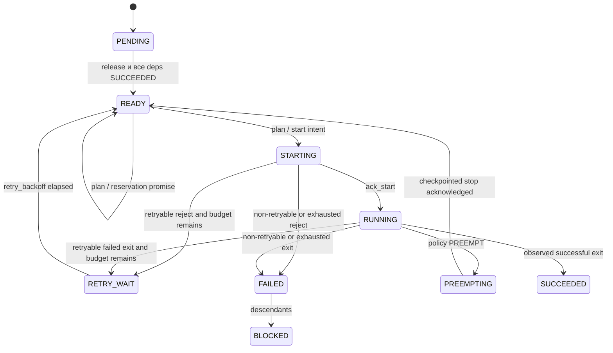

# Online scheduler

`expsched.online` — первый вертикальный slice live-планирования поверх существующих доменных моделей и
политик. Он принимает реальный `Problem`, передаёт политикам обычный `Snapshot` и валидирует их `Decision`,
но, в отличие от `engine/simulator.py`, не создаёт событие завершения по длительности задачи.

## Быстрый пример

```python
from expsched.domain.models import Problem, Task, Worker
from expsched.domain.resources import Resources
from expsched.online import OnlineScheduler
from expsched.policies.fifo import FifoPolicy

worker = Worker("worker-1", Resources({"cpu": 8, "license": 1}))
task = Task("train", duration=30, resources=Resources({"cpu": 4, "license": 1}))
scheduler = OnlineScheduler(Problem({task.id: task}, {worker.id: worker}), FifoPolicy())

(intent,) = scheduler.plan(now=0)       # READY -> STARTING, ресурсы уже удерживаются
send_to_worker(intent)
scheduler.ack_start("ack/train/1", intent, now=1)  # STARTING -> RUNNING

# end_pred — только прогноз. Даже после него задача остаётся RUNNING.
scheduler.task_exited("exit/train/1", intent, success=True, now=28)
assert scheduler.statuses["train"] == "SUCCEEDED"
```

`send_to_worker` в примере — код интеграции с конкретной системой исполнения и не входит в пакет.

## Публичный API

Пакет экспортирует:

- `OnlineScheduler(problem, policy)` — coordinator с одним последовательным writer;
- `StartIntent` — неизменяемое описание попытки запуска;
- `ReservationIntent` — текущий promise policy `(task, worker, t_res)`;
- `PreemptionIntent` — запрос checkpoint/stop конкретной running attempt;
- `TaskPhase` — `PENDING`, `READY`, `RETRY_WAIT`, `STARTING`, `RUNNING`, `PREEMPTING`, `SUCCEEDED`, `FAILED`, `BLOCKED`;
- `OnlineError` и специализированные ошибки валидации.

Основные операции `OnlineScheduler`:

| Метод | Назначение |
|---|---|
| `plan(now)` | Атомарно валидировать START/RESERVE/PREEMPT batch; вернуть starts либо создать `preemptions` |
| `ack_start(event_id, intent, now=...)` | Подтвердить реальный запуск |
| `reject_start(event_id, intent, now=..., retryable=...)` | Отклонить запуск, освободить intent и повторить его в пределах retry budget либо завершить задачу |
| `task_exited(event_id, intent, success=..., retryable=..., now=...)` | Зафиксировать фактический exit и уже классифицированную executor-ом retryability |
| `complete_preemption(event_id, intent, now=...)` | Подтвердить durable checkpoint + proven stop, освободить ресурсы и вернуть victim в READY |
| `submit_task(event_id, task, now=...)` | Добавить задачу, зависимости которой уже известны |
| `worker_down(...)` / `worker_up(...)` | Изменить доступность существующего worker |
| `snapshot()` | Получить текущий `Snapshot` для наблюдения |

`now` — неотрицательное целое логическое время; назад оно не переводится. `statuses`, `attempts`,
`retry_ready_at`, `reservations`, `preemptions`, `problem` и `now` доступны как read-only свойства. Каждый `StartIntent` имеет стабильный
`attempt_id` вида `<task>:<attempt>`.

## Lifecycle и ресурсы



Ресурсы вычитаются при создании `StartIntent`: это предотвращает двойную выдачу, пока start находится in
flight. Ack ресурсы не меняет. Они возвращаются только после `reject_start` или фактического `task_exited`.
Ключи ресурсов не фиксированы: используются операции существующего `Resources`, поэтому одинаково работают
`gpu`, `cpu`, `ram_gb`, лицензии и любые другие ключи.

`Task.duration` трактуется только как `duration_estimate`. `StartIntent.end_pred` прогнозирует окончание при
немедленном старте, а после ack `Snapshot.running[*].end_pred` пересчитывается от времени подтверждения.
Оба значения помогают policy оценивать будущую доступность, но coordinator **никогда** не переводит задачу в
terminal по наступлению прогноза. Если задача пережила прогноз, следующий snapshot оставляет ей положительный
остаток и сдвигает `end_pred` как минимум на следующий tick. Terminal-событие приходит только от executor через
`task_exited`.

Успешный exit освобождает прямых зависимых после выполнения всех их dependencies. Для failed exit или
rejected start вызывающий executor явно передаёт `retryable`: scheduler не знает runtime-specific error codes.
Если failure retryable и номер текущей попытки не превышает `Task.max_retries`, задача переходит в
`RETRY_WAIT`, а через `Task.retry_backoff` снова попадает в обычный `READY` snapshot. Иначе она становится
`FAILED` и рекурсивно переводит незавершённых потомков в `BLOCKED`. `max_retries` — число дополнительных
попыток после первой; каждый новый intent получает следующий attempt number и новый `attempt_id`.

## Детерминизм и защита от повторов

Policy видит те же `Problem`, `Task`, `Resources`, `Snapshot`, `Decision` и результат `analyze`, что и offline
ядро. Весь список решений сначала проверяется на текущем snapshot и временной копии свободных ресурсов. Если
хотя бы одно решение ошибочно, ни один intent из списка не создаётся. Валидные intents возвращаются в
каноническом порядке `(task, worker, attempt)` независимо от порядка словарей.

`Decision(action="START" | "RESERVE" | "PREEMPT", ...)` валидируются одним атомарным batch. Если batch
содержит PREEMPT, online engine создаёт только preemption intents и не применяет START, который policy
рассчитала на ещё не освобождённых ресурсах. После подтверждённых checkpoint/stop executor вызывает
`complete_preemption`, и обычная policy на следующей эпохе заново выбирает urgent START. Поэтому async runtime
никогда не получает ресурсы жертвы раньше доказанного stop.

`RESERVE` не занимает ресурсы сам по себе: это текущий promise policy начать READY-задачу на worker не позже
`t_res`. На каждом `plan(now)` policy заново вычисляет его из фактических runs и положительных end forecasts.
Если реальная задача пережила прогноз, её `end_pred` сдвигается, и reservation тоже сдвигается вместо
синтетического завершения. Worker down/up и другие изменения, делающие старый promise потенциально неверным,
очищают его до следующего policy epoch.

Каждая внешняя мутация имеет непустой `event_id`. Повтор идентичного события — no-op даже после продвижения
логического времени; повтор того же id с другим типом, временем или payload даёт `EventConflictError`.
Неуспешно валидированное событие не запоминается и может быть исправлено с тем же id.

## Worker down/up и ограничения slice

`worker_down` запрещает новые старты и показывает нулевой `free`, но не считает процессы завершившимися и не
освобождает их allocations. После `worker_up` свободная ёмкость пересчитывается как capacity минус все intents
и runs, для которых ещё не было reject/exit. Intent на упавшем worker нельзя ack-нуть: его нужно явно reject-нуть.

Ограничения текущей версии:

- только один последовательный writer; встроенного durable event store нет;
- idempotency хранится в памяти процесса;
- workers нельзя добавлять или менять их capacity, можно только переключать up/down;
- входной `Problem` должен иметь пустой `events` и строгий DAG с известными dependencies и хотя бы одним
  eligible worker для каждой задачи;
- `submit_task` добавляет только новую вершину со ссылками на уже известные задачи;
- retry, reservation и scheduler-side preemption handshake реализованы; durable checkpoint/stop/restore
  orchestration предоставляет внешний control plane; cancellation пока не реализован.
